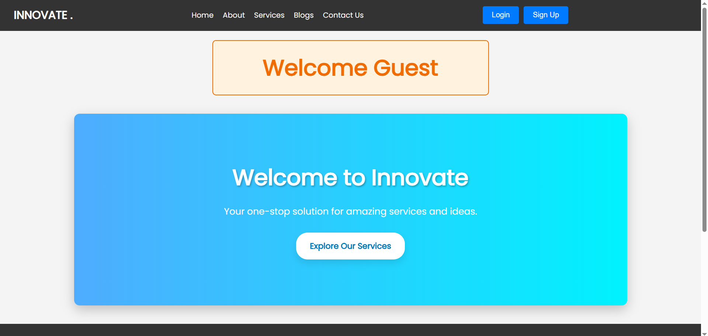
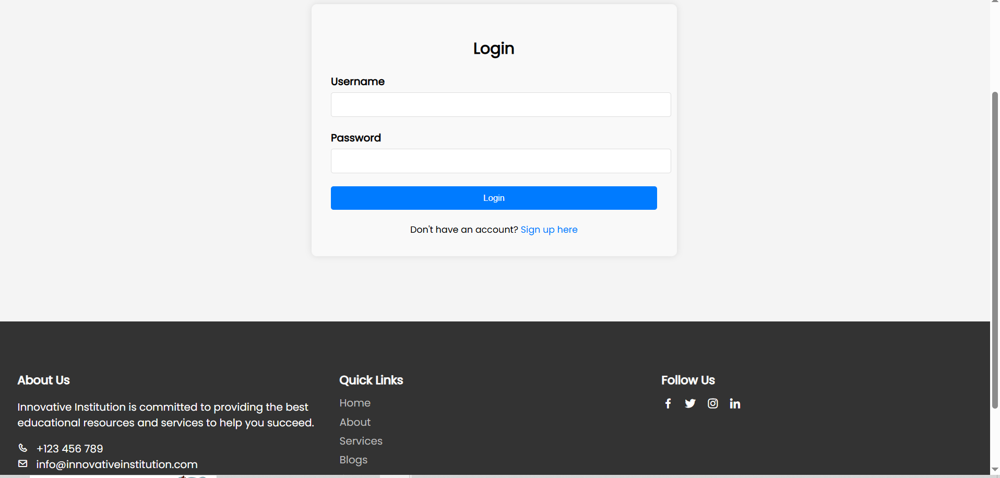
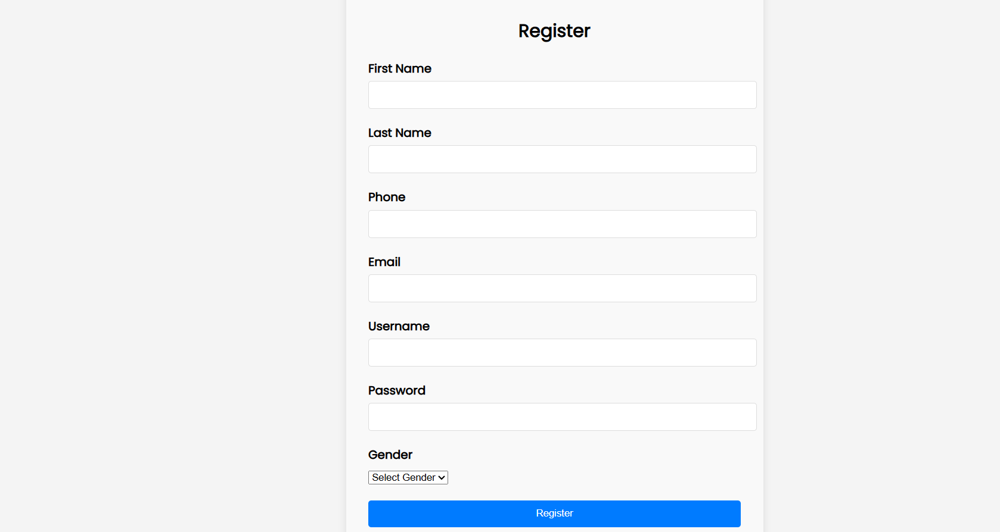
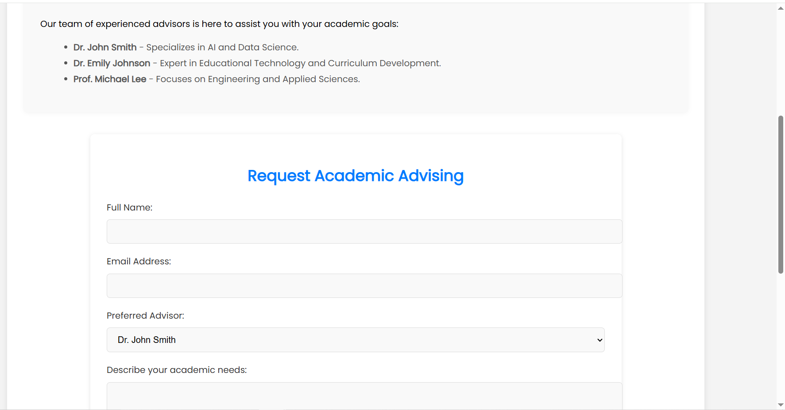

# 🏫 Institution Management System  

## 📌 Overview  
The **Institution Management System** is a **web-based application** built using Laravel, PHP, and Blade templating, designed to streamline administrative processes in educational and training institutions. The system provides **user authentication, student and staff management, course handling, and dynamic reporting** with an intuitive interface powered by Bootstrap and JavaScript.  

## 🚀 Features  
✅ **User Authentication** – Secure login and role-based access (Admin, Staff, Students).  
✅ **Student & Staff Management** – CRUD operations for users and records.  
✅ **Course & Class Management** – Assign courses, track progress, and schedule classes.  
✅ **Attendance Tracking** – Monitor student and staff attendance.  
✅ **SQL Database** – Efficient data storage and management.  
✅ **Blade Templating** – Dynamic UI rendering using Laravel Blade.  
✅ **Bootstrap & JS** – Responsive and interactive UI.  
✅ **Data Validation & Security** – Prevents SQL injection and unauthorized access.  

## 📸 Screenshots  

### 🏠 Landing & Authentication
| **Home Page** | **Login & Registration** |
| :---: | :---: |
|  |  |
| *The main landing page of the system.* | *Secure access for users.* |

### 🛠️ Core Services
| **Register New Account** | **Services Overview** |
| :---: | :---: |
|  |  |
| *User-friendly registration flow.* | *List of available institutional services.* |

### 🎓 Academic Services
<p align="center">
  
  <br>
  <i>Academic Advising Module</i>
</p>

## 🛠️ Technologies Used  
- **Framework:** Laravel (PHP)  
- **Frontend:** Blade (Laravel), HTML5, CSS3, JavaScript, Bootstrap  
- **Backend:** Laravel (PHP-based MVC framework)  
- **Database:** MySQL (SQL-based relational database)  
- **IDE:** VS Code  

## 📂 Project Structure  

```

/institution-management-system
│── app/              # Laravel app logic (controllers, models, middleware)

│── database/         # Migrations and seeders

│── public/           # Public assets (CSS, JS, images)

│── resources/        # Blade templates and frontend assets

│── routes/           # Web and API route definitions

│── .env              # Environment configuration (database & app settings)

│── composer.json     # Laravel dependencies

│── package.json      # Frontend dependencies

```

## 🎯 Installation & Setup  
1. **Clone the Repository** ```bash
   git clone [https://github.com/mohammedalhaj14/Institution-Management-System-Project.git](https://github.com/mohammedalhaj14/Institution-Management-System-Project.git)
   cd Institution-Management-System-Project

```

2. **Install Dependencies** ```bash
composer install
npm install
```


```


3. **Configure the Environment** - Copy `.env.example` to `.env`
* Set up database credentials in `.env`:
```ini
DB_CONNECTION=mysql
DB_HOST=127.0.0.1
DB_PORT=3306
DB_DATABASE=your_database_name
DB_USERNAME=your_username
DB_PASSWORD=your_password

```


4. **Run Migrations & Seeders** ```bash
php artisan migrate --seed
```


```


5. **Generate Application Key** ```bash
php artisan key:generate
```


```


6. **Start the Development Server** ```bash
php artisan serve
```
Open your browser and visit:  
`http://127.0.0.1:8000`

```